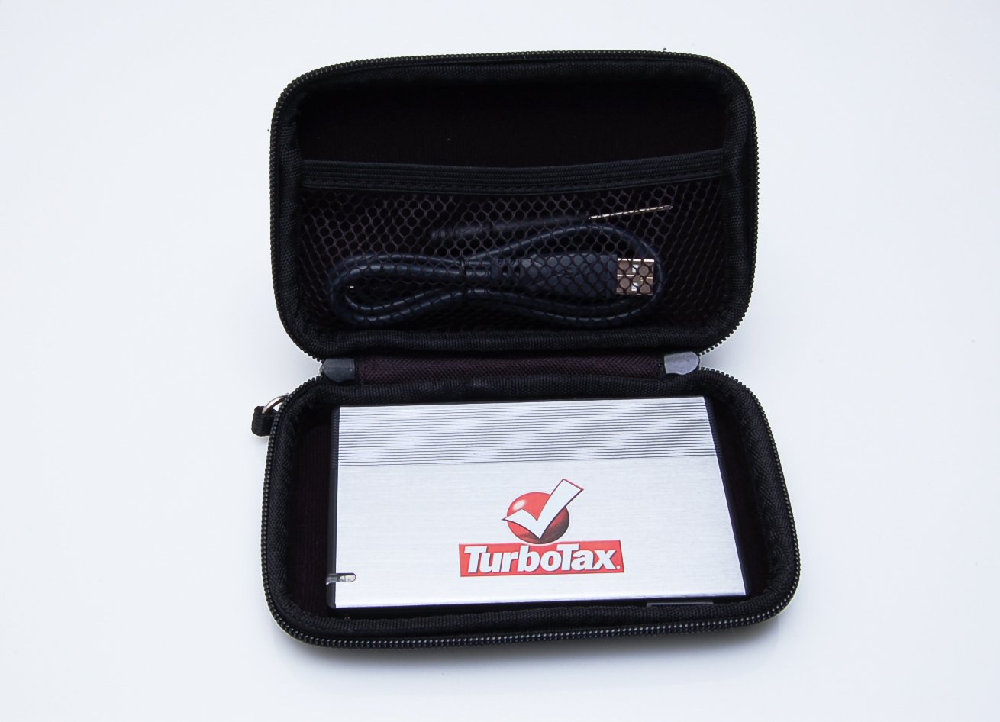

# turbot ax

## What you were actually looking for

Let's be honest — nobody googles "turbot ax." What you meant was **TurboTax**, the tax preparation software from Intuit. The extra space and the swapped "a" are just your fingers getting ahead of your brain. We've all been there. This page is a quick, honest orientation to what TurboTax is, what the different versions do, and the gotchas that trip people up every single year.

## What TurboTax actually is

TurboTax is a consumer tax preparation product. You answer questions about your income, deductions, and life events, and the software fills out the tax forms for you. It's been around since the mid-1980s, originally as a DOS program called Chipsoft, before Intuit bought it in 1993. Over the decades it's become the default name in DIY tax filing, the same way Kleenex means tissue.

It is not a miracle machine. It won't find deductions you don't have, and it won't make your refund bigger than the law allows. What it does well is structure a messy pile of W-2s, 1099s, and receipts into a completed return without you having to learn the underlying forms yourself.

## The versions, roughly

TurboTax comes in a few tiers, and the naming changes more often than you'd like. As of recent cycles, the practical lineup looks like this:

| Edition | Best for |
| --- | --- |
| **Free** | Simple W-2 income, standard deduction only |
| **Deluxe** | Homeowners, charitable donations, some deductions |
| **Premier** | Investments, rental property, capital gains |
| **Self-Employed** | 1099 income, gig work, small business expenses |

The exact feature split shifts year to year, and Intuit has moved toward a "pay when you file" model where you pick your edition near the end rather than upfront. That's convenient, but it also means you can sink hours into the interview before you find out what the final price tag is. Check the price screen before you hit submit, not after.

## The two big gotchas

**The "free" edition is genuinely limited.** TurboTax Free handles W-2 income and the standard deduction. The moment you have a 1099-INT from a savings account, a side gig, or a stock sale, you'll be pushed toward a paid tier. It's not a bait-and-switch — the free tier really is free — but it's easy to misread the marketing and assume "free" means "free for everyone." It doesn't.

**The interview is long, and it repeats itself.** The software asks the same question in three different ways to make sure you didn't misunderstand. That's by design — it's checking for consistency. But it means a "30-minute" filing can stretch to two hours if you have anything unusual. Budget the time, or you'll rush the last screens and make a mistake.

## A few honest notes

- **You can switch to a human preparer mid-way.** If you start in TurboTax and realize your situation is too tangled, you can export your data and take it to an accountant. You're not locked in.
- **The desktop version and the online version differ.** Online is the default now; the downloadable desktop software still exists but is increasingly an afterthought. If you prefer owning a file on your machine, check that the desktop edition is still offered before you assume it is.
- **State returns are almost always extra.** The federal filing is the headline price; your state return costs more on top. Factor that in when comparing against other software.

## Should you use it?

If your taxes are simple to moderately complicated, TurboTax is a reasonable, mainstream choice. It's not the cheapest option — competitors like FreeTaxUSA undercut it on price — and it's not the most powerful option, since a human accountant will always beat software on genuinely unusual situations. It wins on polish, question clarity, and the sheer amount of hand-holding.

If you're comfortable reading tax forms yourself, you can save money elsewhere. If you'd rather not think about the forms at all and you're willing to pay for a guided interview, TurboTax does the job. The "turbot ax" search was a typo, but the answer you wanted is the same: it's tax software, it's fine, and it's not magic.

---

## Repo assets

The classic TurboTax van, spotted in Williamsburg. Photo by His Imperial Majesty, an Emperor of Emperors · Wikimedia Commons.

TurboTax promotional USB hard drives — a piece of the brand's older marketing era. Photo via Wikimedia Commons.

---

*This repository is a fan-made reference note. It is not d with, endorsed by, or supported by Intuit or TurboTax. TurboTax is a registered trademark of Intuit Inc.*